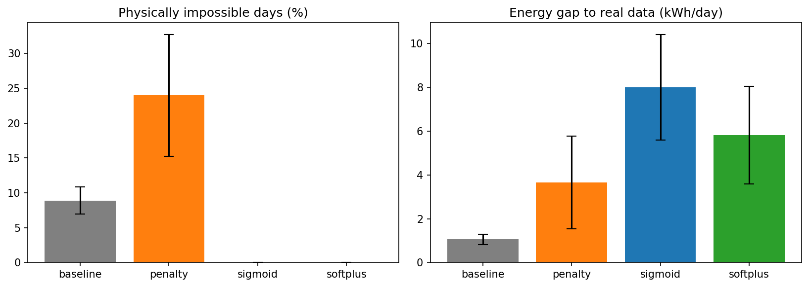
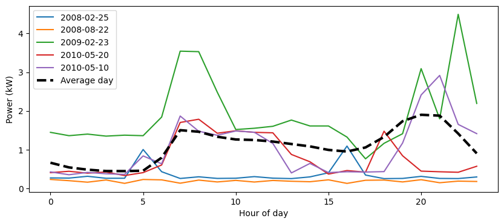
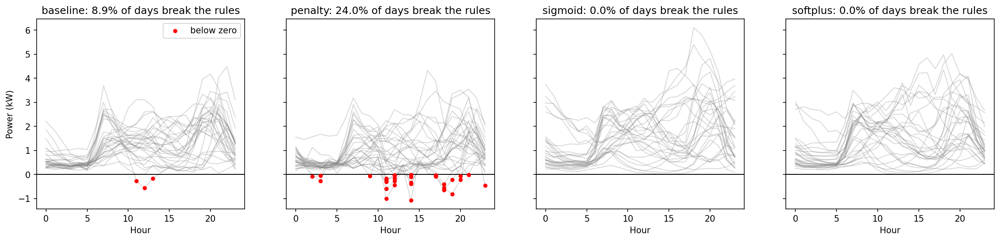
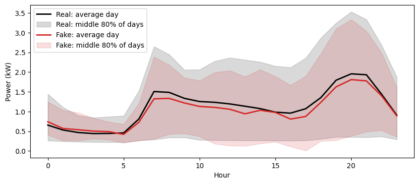

# Physics constraints in a VAE for household electricity profiles

A small PyTorch project comparing ways to stop a generative model from producing
physically impossible electricity-use profiles, using four years of real data
from one household.

## The question

A variational autoencoder (VAE) trained on real daily electricity profiles can
generate new, synthetic days. But nothing stops it from producing impossible
values, such as negative power. I compared three ways of enforcing physics
against an unconstrained baseline:

| Method | How the constraint is applied |
|---|---|
| **Baseline** | No constraint |
| **Penalty** | Extra loss term punishing negative or over-limit outputs (soft constraint) |
| **Sigmoid** | Decoder output squashed into [0, meter cap] (hard constraint) |
| **Softplus** | Decoder output forced above 0, no ceiling (hard constraint) |

## Data

UCI *Individual Household Electric Power Consumption* dataset: one house in
France, one reading per minute, December 2006 to November 2010.

- Resampled to hourly averages; each day becomes 24 numbers (kW).
- Days with any missing hour removed, leaving 1,417 days.
- Split by time: 2006–2009 for training (1,103 days), 2010 for testing (314 days).

**Physical rules:**
1. Power cannot be negative.
2. Power cannot exceed what the supply can deliver. The true contracted limit is
   unknown, so I use the highest one-minute reading ever recorded (11.1 kW) as a
   conservative cap.

## Method

- VAE in PyTorch: MLP encoder and decoder (24 → 64 → 64 → 4-dimensional latent),
  trained with reconstruction loss + β·KL (β = 0.003), Adam, 150 epochs.
- Each method trained with 3 random seeds; results are mean ± standard deviation.
- 10,000 synthetic days generated per model by decoding random codes z ~ N(0, I).
- **Energy gap**: the average kWh difference between the real and synthetic
  daily-energy distributions, compared percentile by percentile (0 = identical).
- **Test recon**: reconstruction error on the 2010 test days (sum of squared
  errors per day, in scaled units).

## Results

| Metric | baseline | penalty | sigmoid | softplus | Real data |
|---|---:|---:|---:|---:|---:|
| % of days with any violation | 8.91 ± 1.92 | 24.01 ± 8.74 | 0.00 ± 0.00 | 0.00 ± 0.00 | 0 |
| lowest value (kW) | -1.08 ± 0.10 | -1.34 ± 0.29 | 0.01 ± 0.01 | 0.01 ± 0.00 | 0.12 |
| energy gap (kWh) | 1.06 ± 0.24 | 3.66 ± 2.12 | 8.01 ± 2.41 | 5.81 ± 2.23 | 0 |
| energy per day (kWh) | 25.72 ± 0.45 | 23.01 ± 2.37 | 34.41 ± 2.41 | 32.23 ± 2.24 | 26.42 |
| bumpiness (kW) | 0.27 ± 0.00 | 0.29 ± 0.01 | 0.26 ± 0.02 | 0.27 ± 0.02 | 0.45 |
| test recon | 0.11 ± 0.00 | 0.10 ± 0.00 | 0.12 ± 0.02 | 0.11 ± 0.01 | – |

## Findings

**1. The baseline produces physically impossible days.** About 9% of generated
days contain at least one negative hour, mostly around midday and 17:00, when
real usage varies most and sits close to zero. The cap is never reached: the
model makes days too flat, not too high, so for this house the zero rule is the
one that matters.

**2. The soft penalty does not help, and made things worse here.** The penalty
only acts on *reconstructed training days*, and those were already valid
(0.27% of baseline reconstructions go negative, 0.00% with the penalty). Brand-new
days generated from random codes are never checked during training, so the
penalty has almost nothing to fix.

**3. Hard constraints guarantee validity but bias the energy.** Sigmoid and
softplus give 0% impossible days by construction, but generated days use about
22–30% more energy than real days. Reconstructed days are *not* biased (25.8–26.0
kWh/day vs 26.4 real), so the bias comes from *sampling*, not from what the model
learned. Softplus is slightly less biased than sigmoid, but the difference is
within the seed-to-seed spread.

**4. A likely cause is a mismatch between the prior and the data in latent space.**
For the baseline, the latent codes of real days spread out almost like the N(0, 1)
distribution used for sampling (standard deviation 0.93–0.98), and its generated
energy matches the real data. For the penalty, sigmoid and softplus models the
codes are narrower (0.70–0.90), so many random codes land where no real day sits,
and generated energy is off. This is consistent with the bias, but not proof,
because the measure only uses each day's centre code.

## Limitations

- One household, one model size, three seeds.
- All VAEs produce days that are too smooth: average hour-to-hour change is about
  0.27 kW vs 0.45 kW in real data.
- The meter cap is an assumption, not the true contracted limit.
- The test year (2010) has no December and is less variable than the training
  years, which makes it slightly easier than the training data.

## Next steps

- Close the prior–data gap: a learned prior (e.g. a VampPrior), or applying the
  physics penalty to *generated* samples during training, not just reconstructions.
- Try models better at sharp spikes, such as diffusion models.
- Extend to many households and to multi-day sequences.

## How to run

1. Download the dataset from the UCI Machine Learning Repository and place
   `household_power_consumption.txt` in a folder called `data/`.
2. Install: `pip install -r requirements.txt`
3. Run `01_data.ipynb` (data preparation), then `02_vae.ipynb` (models and results).

## Reference

Hebrail, G. & Berard, A. (2006). *Individual Household Electric Power Consumption*
[Dataset]. UCI Machine Learning Repository. https://doi.org/10.24432/C58K54

Author: Zaki Ahmed
